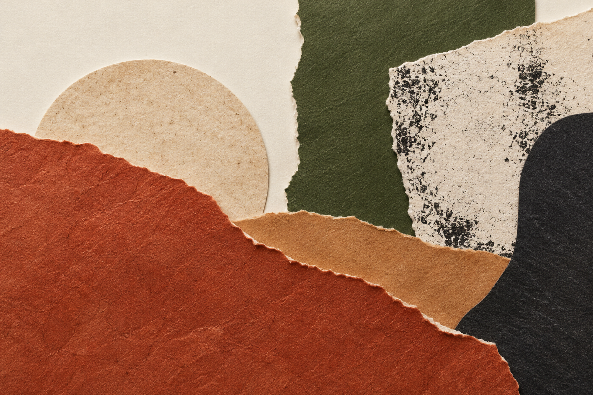
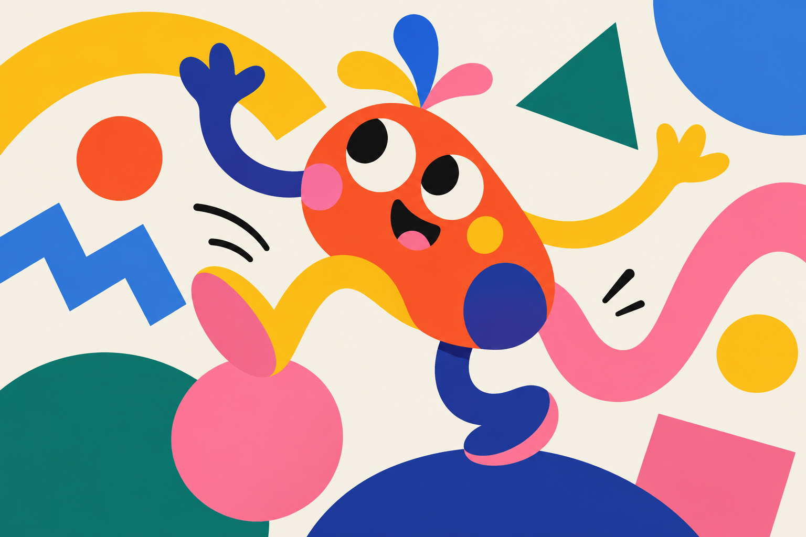

# Design Trends 2027

**Jeden skill dla agenta. Dziesięć kierunków wizualnych. Konkretne decyzje zamiast ślepego podążania za modą.**


[Obejrzyj galerię kierunków →](https://aievolutionpl.github.io/design-trends-2027/) · [Przejdź do SKILL.md](skills/design-trends-2027/SKILL.md) · [Poznaj źródła](skills/design-trends-2027/references/sources.md)

To repozytorium zawiera **jeden przenośny skill** `design-trends-2027`, a nie dziesięć osobnych skilli. Pomaga agentowi dobrać i zastosować kierunek wizualny w grafice, identyfikacji, kampanii lub interfejsie: od briefu i wyboru stylu po wykonanie oraz kontrolę czytelności i dostępności.

Pierwszych **siedem kierunków** to praktyczne interpretacje tematów z [wskazanego filmu](https://youtu.be/6m7Y5SKXhks). Kolejne **trzy** są dodatkami redakcyjnymi opartymi na osobnych źródłach. Wszystkie należy traktować jako **prognozy i hipotezy twórcze**, nie ranking popularności, dowód skuteczności ani pomiar rynku w 2027 roku. Kierunki mogą się przenikać; nie trzeba wykorzystywać wszystkich.

## Inspiracje wizualne

Trzy **ilustracje wygenerowane przez AI** pokazują różne sposoby interpretacji kierunków. Papier w pierwszej grafice nie jest skanem prawdziwej pracy ręcznej; forma liter w drugiej jest dekoracyjna i nie zastępuje czytelnej typografii użytkowej.


*Handmade i analog · prawdziwe faktury — inspiracja wizualna*


*Surrealizm · typografia z osobowością — inspiracja wizualna*


*Cute-morphism · ekspresyjna geometria — inspiracja wizualna*

## Instalacja skilla

**Punktem wejścia jest [`skills/design-trends-2027/SKILL.md`](skills/design-trends-2027/SKILL.md).** Zainstaluj cały katalog `design-trends-2027`, włącznie z `references/` — sam plik `SKILL.md` nie zawiera pełnych wskazówek i źródeł.

1. Sklonuj repozytorium do nowego katalogu i przejdź do niego:

   ```sh
   git clone https://github.com/aievolutionpl/design-trends-2027.git
   cd design-trends-2027
   ```

   Jeśli katalog już istnieje, użyj innej nazwy docelowej dla `git clone` albo przejdź do posiadanej kopii po sprawdzeniu jej zawartości.

2. Sprawdź w dokumentacji swojego agenta, gdzie odkrywa lokalne skille, i ustaw `SKILLS_DIR` na **istniejący** katalog skilli. Poniższy przykład nie nadpisuje istniejącego katalogu o tej samej nazwie:

   ```sh
   # Wpisz właściwą ścieżkę dla swojego agenta:
   SKILLS_DIR="$HOME/SCIEZKA/DO/KATALOGU_SKILLI"
   test -d "$SKILLS_DIR" || { echo "Katalog skilli nie istnieje"; exit 1; }

   if mkdir "$SKILLS_DIR/design-trends-2027"; then
     if cp -R skills/design-trends-2027/. "$SKILLS_DIR/design-trends-2027/"; then
       echo "Skopiowano skill wraz z references/."
     else
       echo "Kopiowanie nie powiodło się; sprawdź zawartość katalogu." >&2
     fi
   else
     echo "Nie utworzono katalogu — sprawdź, czy już istnieje lub czy masz uprawnienia." >&2
   fi
   ```

   Jeżeli kopiowanie zostanie przerwane, sprawdź zawartość nowo utworzonego katalogu przed ponowną próbą. Nie zastępuj istniejącego skilla bez wcześniejszego sprawdzenia jego zawartości i decyzji o aktualizacji.

3. Uruchom ponownie agenta lub odśwież jego listę skilli, jeśli wymaga tego jego środowisko. Poproś go o użycie `design-trends-2027`. Mechanizm wykrywania różni się między agentami; automatyczne ładowanie nie zostało sprawdzone dla każdego z nich. Jeśli agent nie obsługuje skilli, wskaż mu `SKILL.md` oraz katalog `references/` bezpośrednio.

## Jak korzystać

Podaj agentowi **medium, odbiorcę, markę, cel, treść i format końcowy**. Dołącz materiały, do których masz prawa, oraz ograniczenia techniczne i dostępności. Skill prowadzi agenta przez następujący proces:

1. Rozpoznaj zadanie i wybierz **jeden kierunek główny oraz maksymalnie dwa pomocnicze**; wyjaśnij wybór i kompromisy.
2. Określ hierarchię, typografię, paletę, kompozycję, obrazy lub materiały, a w interfejsie również interakcje.
3. Przygotuj zamówiony projekt, plik lub kod, jeśli dostępne są niezbędne narzędzia i materiały — nie kończ na samym moodboardzie.
4. Sprawdź komunikat, czytelność w docelowym rozmiarze, prawa do materiałów i prawdziwość deklaracji. W projektach interaktywnych uwzględnij także klawiaturę, fokus, kontrast, ograniczenie ruchu i wydajność.
5. Jeśli potrzebna jest ocena, zaproponuj hipotezę i porównanie z prostszym wariantem; nie wymyślaj wyników testów.

### Trzy gotowe prompty

**1. Plakat produktu**

> Użyj skilla `design-trends-2027`. Zaprojektuj plakat 1080 × 1350 dla niezależnej palarni kawy: odbiorcy to osoby kupujące kawę do domu, cel to promocja degustacji, a tekst to „Sobota, 11:00 — degustacja w palarni”. Wybierz handmade jako kierunek główny, a realną fakturę jako pomocniczą. Zaproponuj kompozycję, typografię, miejsce na zdjęcie i przygotuj plik, jeśli masz narzędzia. Nie przedstawiaj wygenerowanej faktury jako rzeczywiście wykonanej ręcznie. Sprawdź czytelność na telefonie.

**2. Interfejs B2B**

> Użyj skilla `design-trends-2027` do zaprojektowania ekranu dashboardu B2B do monitorowania zamówień. Odbiorcą jest zespół operacyjny, celem szybkie znalezienie opóźnionych zamówień. Zaproponuj ekspresyjną geometrię jako akcent, ale zachowaj rozpoznawalne przyciski, etykiety, widoczny fokus i czytelną tabelę. Przygotuj implementację w istniejącym stosie projektu oraz sprawdź działanie na urządzeniach mobilnych i z klawiaturą. Nie wymyślaj wyników testów użytkowników.

**3. Ulotka wydarzenia**

> Użyj skilla `design-trends-2027`. Przygotuj koncepcję i możliwy do edycji projekt ulotki A5 dla lokalnego festiwalu ilustracji: „Festiwal Rysunku”, 18 czerwca, Dom Kultury, wstęp wolny. Sprawdź, czy świadomie naiwny styl pasuje do odbiorców, i zaproponuj jeden kierunek pomocniczy. Zostaw wyraźny blok informacji; zweryfikuj czytelność w rozmiarze wydruku i prawa do użytych ilustracji. Jeśli brakuje materiału marki, oznacz placeholder zamiast go wymyślać.

## 10 kierunków w praktyce

### 1. Handmade i analog

**Na czym polega:** widoczne materiały, wycinanki, farba, papier i nieregularności zestawione z uporządkowaną kompozycją. **Kiedy:** plakaty kulinarne, opakowania rzemieślnicze, okładki i kampanie. **Unikaj:** ogólnej tekstury na wszystkim, słabego kontrastu oraz nazywania generowanej imitacji pracą wykonaną ręcznie.

### 2. Cute-morphism — sympatyczna postać

**Na czym polega:** prosta, charakterystyczna maskotka z ograniczoną paletą i spójnym zestawem ekspresji. **Kiedy:** edukacja, onboarding i przyjazne kampanie, jeśli ton pasuje odbiorcom. **Unikaj:** zasłaniania funkcji, błędów lub ryzyk osobowością bohatera oraz przerywania użytkownikowi zadania.

### 3. Proces i niedoskonałość

**Na czym polega:** pokazanie prawdziwych szkiców, zmian i decyzji jako części opowieści o gotowym projekcie. **Kiedy:** portfolio, case study, premiery i karuzele o kulisach pracy. **Unikaj:** fikcyjnych szkiców i zatwierdzeń, ujawniania poufnych materiałów oraz chaosu, który przesłania rezultat.

### 4. Prawdziwe faktury

**Na czym polega:** fotografowanie lub skanowanie rzeczywistych materiałów związanych z tematem, np. tkaniny, papieru czy opakowania. **Kiedy:** identyfikacje lokalne, okładki, plakaty i opowieści o produkcie. **Unikaj:** przypadkowego ziarna bez związku z historią i drobnego tekstu na nieprzewidywalnym tle; sprawdź prawa do materiałów.

### 5. Surrealizm

**Na czym polega:** świadoma zmiana jednej reguły — skali, grawitacji lub kontekstu — przy spójnym świetle i perspektywie. **Kiedy:** kampanie premierowe, ilustracje redakcyjne i konceptualne reklamy. **Unikaj:** wielu niepowiązanych efektów i sugerowania, że fikcyjna scena lub instalacja wydarzyła się naprawdę.

### 6. Typografia z osobowością

**Na czym polega:** liternictwo staje się głównym obrazem, a spokojny krój wspiera dłuższy tekst. **Kiedy:** okładki, kampanie i identyfikacje typograficzne. **Unikaj:** dekoracyjnego kroju w długim tekście; sprawdź polskie znaki, licencję, łamanie na małym ekranie i czytelność.

### 7. Świadomie naiwny „dumb design”

**Na czym polega:** celowo niezgrabna estetyka, proste kroje, clip art i kontrolowana asymetria. **Kiedy:** oddolne wydarzenia, humorystyczne kampanie lub społeczności, którym odpowiada taki ton. **Unikaj:** mylenia zamierzonej prostoty z niedbałością — informacje i działanie muszą pozostać jasne. To najbardziej spekulatywna propozycja autora filmu.

### 8. Dynamiczne materiały i kontrolowana przezroczystość

**Na czym polega:** oszczędne użycie warstw przypominających szkło, by pokazać głębię i hierarchię interfejsu. **Kiedy:** pływająca nawigacja i kontrolki, gdy warstwowanie pomaga orientacji. **Unikaj:** rozmywania każdej karty i nakładania tekstu na niestabilne tło; zapewnij czytelną, nieprzezroczystą alternatywę. Przykład Apple jest inspiracją, nie pomiarem rynku.

### 9. Ekspresyjna geometria

**Na czym polega:** kilka spójnych reguł kształtu, proporcji i koloru nadaje interfejsowi charakter marki. **Kiedy:** strony marek, onboarding i wybrane elementy nawigacji. **Unikaj:** kształtów udających przyciski, oznaczania stanów wyłącznie kolorem i rezygnacji ze znanych kontrolek.

### 10. Ruch z funkcją

**Na czym polega:** animacja pomaga zrozumieć zmianę stanu, orientację lub narrację, zamiast być wyłącznie ozdobą. **Kiedy:** przejścia między krokami, informacja zwrotna i opowieści redakcyjne. **Unikaj:** ciągłego ruchu, przejmowania przewijania i ukrywania niezbędnych treści za animacją; zapewnij wersję statyczną i respektuj ograniczenie ruchu.

## Zawartość repozytorium

- [`skills/design-trends-2027/SKILL.md`](skills/design-trends-2027/SKILL.md) — instrukcja i punkt wejścia dla agenta.
- [`references/application-recipes.md`](skills/design-trends-2027/references/application-recipes.md) — konkretne receptury projektowe, antywzorce i testy dla każdego kierunku.
- [`references/video-directions.md`](skills/design-trends-2027/references/video-directions.md) — szczegółowe wskazówki do siedmiu kierunków z filmu.
- [`references/additional-directions.md`](skills/design-trends-2027/references/additional-directions.md) — trzy dodatkowe kierunki.
- [`references/sources.md`](skills/design-trends-2027/references/sources.md) — źródła, znaczniki czasu i ograniczenia interpretacji.
- `index.html`, `style.css`, `favicon.svg`, `hero.png` — statyczna galeria; `DESIGN.md` opisuje jej decyzje projektowe, a `evidence/` zawiera materiały z badań i QA.

Galerię można też uruchomić lokalnie, bez instalacji zależności i kompilacji:

```sh
python3 -m http.server 8000
# Otwórz http://localhost:8000
```

## Źródła i zastrzeżenia

- [Film źródłowy](https://youtu.be/6m7Y5SKXhks) — siedem pierwszych tematów; pełnej transkrypcji nie dołączono.
- [Osobny artykuł o podobnych siedmiu kierunkach](https://whattheweb.co.in/7-graphic-design-trends-for-2027-and-how-to-make-them-with-ai/) — źródło wtórne, nie dowód tożsamości filmu ani popularności kierunków.
- [Apple: Liquid Glass](https://developer.apple.com/videos/play/wwdc2025/219/) oraz [Google: Material 3 Expressive](https://design.google/library/expressive-material-design-google-research) — przykłady i materiały producentów dotyczące materiału oraz ekspresyjnego systemu.
- [MDN: animacje sterowane przewijaniem](https://developer.mozilla.org/en-US/docs/Web/CSS/Guides/Scroll-driven_animations) i [media queries dla dostępności](https://developer.mozilla.org/en-US/docs/Web/CSS/Guides/Media_queries/Using_for_accessibility) — możliwości techniczne i ograniczenie ruchu; zgodność przeglądarek należy sprawdzić dla konkretnego projektu.

Tekst, kod i demonstracyjne ilustracje współtworzono z pomocą AI. Nie przedstawiają oryginalnych materiałów ani reprodukcji prac pokazanych w filmie. Skill wspiera decyzje projektowe, ale nie gwarantuje jakości, zgodności z dostępnością ani wyników biznesowych.
