# Design Trends 2027

**AI Evolution Polska przedstawia katalog 30 kierunków wizualnych dla projektantów i agentów AI.**

Rok 2027 to horyzont twórczych prognoz i hipotez, nie potwierdzony ranking, pomiar popularności ani gwarancja skuteczności. Każdy kierunek można dostosować do medium, odbiorcy i marki. Wizualizacje są syntetycznymi interpretacjami, a nie dowodem rzeczywistych materiałów ani popularności.

[Przenośny skill](skills/design-trends-2027/SKILL.md) · [Wszystkie instrukcje i prompty](skills/design-trends-2027/references/application-recipes.md#instrukcje-i-gotowe-prompty-po-polsku) · [Źródła i ograniczenia](skills/design-trends-2027/references/sources.md)

## Jak korzystać

Wybierz kierunek główny, najwyżej dwa uzupełniające, a następnie otwórz jego recepturę. Wklej prompt do agenta projektowego, uzupełnij pola w nawiasach i zweryfikuj gotowy rezultat.

## Katalog stylów

### 01. Handmade / analog

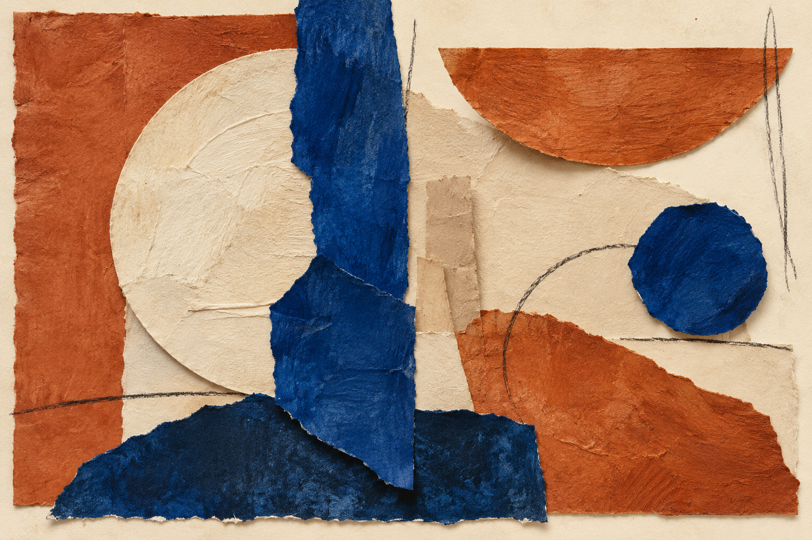

**Podstawy:** ciepło ręcznej pracy i materialne niedoskonałości. **Kiedy używać:** rzemiosło, gastronomia, marki autorskie.

**Kompozycja:** jeden papierowy bohater i spokojny blok informacji. **Kolor:** krem, grafit, ceglasty akcent. **Typografia:** ekspresyjny szeryf i prosty krój tekstowy.

**Materiały:** autoryzowany papier, farba lub skan. **Unikać:** nie sugeruj rzeczywistego rękodzieła przy syntetycznej fakturze.

[Instrukcja i prompt do skopiowania →](skills/design-trends-2027/references/application-recipes.md#styl-01)

### 02. Cute character

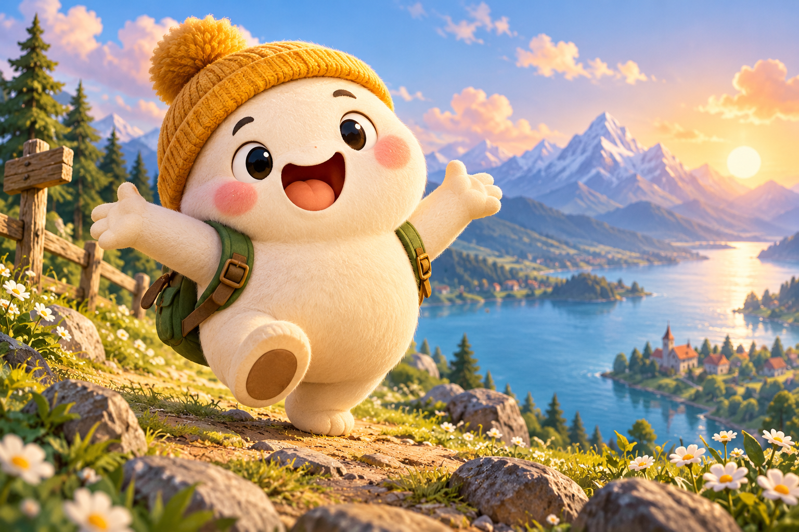

**Podstawy:** oryginalna przyjazna postać o spójnych proporcjach. **Kiedy używać:** edukacja i onboarding.

**Kompozycja:** postać obok wyraźnego działania, nie zamiast niego. **Kolor:** krem, granat i koral. **Typografia:** zaokrąglony nagłówek, czytelny sans.

**Materiały:** autorska ilustracja, zestaw mimiki i wersja monochromatyczna. **Unikać:** nie zastępuj ostrzeżeń maskotką ani nie kopiuj cudzych postaci.

[Instrukcja i prompt do skopiowania →](skills/design-trends-2027/references/application-recipes.md#styl-02)

### 03. Process / imperfection

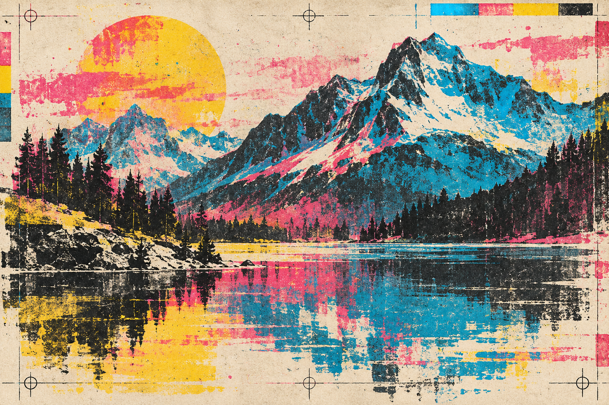

**Podstawy:** prawdziwe decyzje i ślady pracy. **Kiedy używać:** portfolio i studia przypadku z udokumentowanym procesem.

**Kompozycja:** wynik przed trzema chronologicznymi etapami. **Kolor:** złamana biel, grafit, niebieskie adnotacje. **Typografia:** redakcyjny szeryf i czytelne podpisy.

**Materiały:** zatwierdzone szkice, notatki i fotografie. **Unikać:** nie fabrykuj etapów ani nie ujawniaj poufnych materiałów.

[Instrukcja i prompt do skopiowania →](skills/design-trends-2027/references/application-recipes.md#styl-03)

### 04. Found real textures

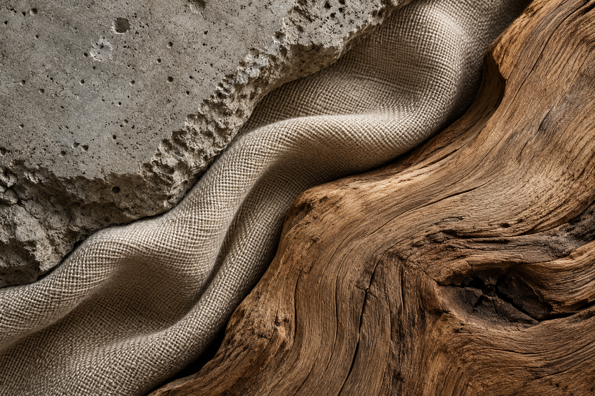

**Podstawy:** istotny dla opowieści rzeczywisty materiał. **Kiedy używać:** produkt tekstylny, miejsce, marka lokalna.

**Kompozycja:** duże pole faktury obok gładkiego panelu tekstu. **Kolor:** barwy materiału, kamień i ciemna zieleń. **Typografia:** mocny prosty nagłówek i czytelny tekst.

**Materiały:** własna lub licencjonowana fotografia tkaniny, kamienia albo drewna. **Unikać:** nie kładź drobnego tekstu na chaotycznej fakturze.

[Instrukcja i prompt do skopiowania →](skills/design-trends-2027/references/application-recipes.md#styl-04)

### 05. Surrealism

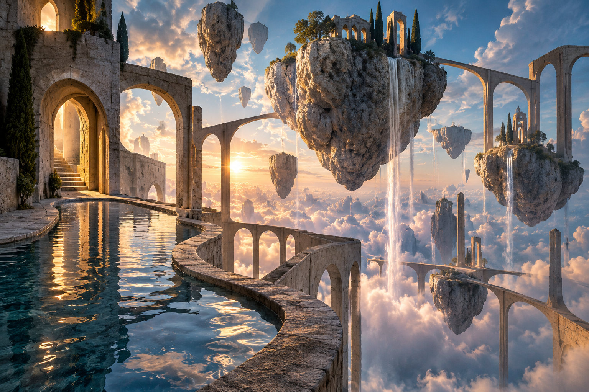

**Podstawy:** jedna niemożliwa zmiana skali, grawitacji lub kontekstu. **Kiedy używać:** kampania ideowa i ilustracja redakcyjna.

**Kompozycja:** jeden bohater z konsekwentną perspektywą, osobne pole komunikatu. **Kolor:** jasne tło, ciemny atrament, jeden ciepły akcent. **Typografia:** prosty mocny sans bez konkurencji z obrazem.

**Materiały:** licencjonowany kolaż lub oznaczony render. **Unikać:** nie przedstawiaj fikcyjnej sceny jako dowodu cech produktu.

[Instrukcja i prompt do skopiowania →](skills/design-trends-2027/references/application-recipes.md#styl-05)

### 06. Expressive typography

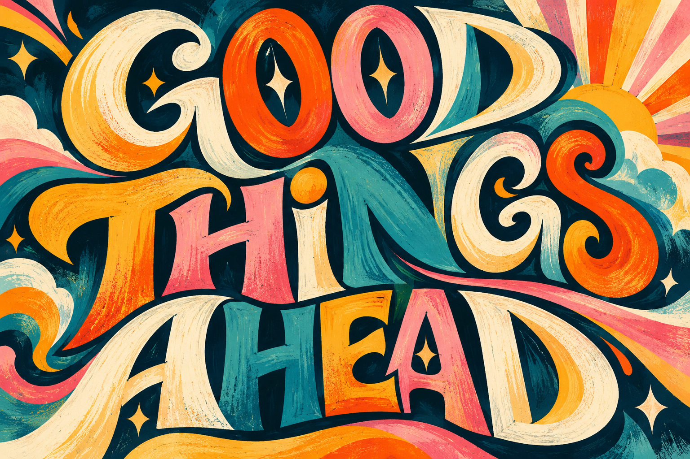

**Podstawy:** liternictwo jako główny obraz. **Kiedy używać:** krótkie hasło, plakat i identyfikacja wydarzenia.

**Kompozycja:** wielki nagłówek i spokojna siatka szczegółów. **Kolor:** biel, czerń, jeden elektryczny akcent. **Typografia:** charakterystyczny krój nagłówka i neutralny tekstowy.

**Materiały:** licencjonowane fonty, edytowalny tekst, ewentualnie prosty wektor. **Unikać:** nie poświęcaj polskich znaków, łamania ani czytelności.

[Instrukcja i prompt do skopiowania →](skills/design-trends-2027/references/application-recipes.md#styl-06)

### 07. Deliberately naive

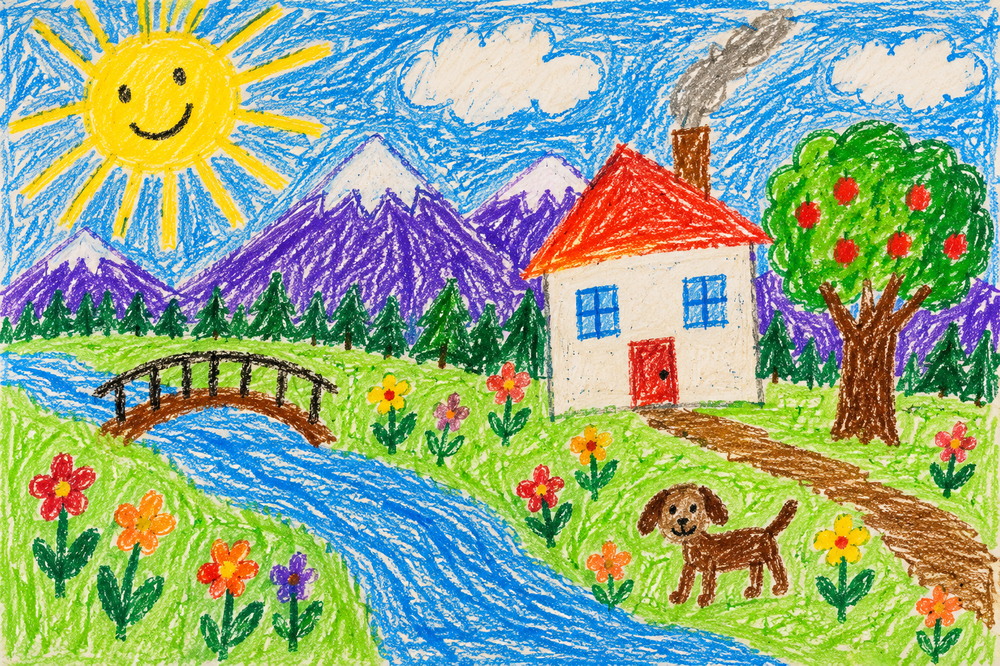

**Podstawy:** świadoma zabawa prostotą i pozorną niezręcznością. **Kiedy używać:** wydarzenie społeczne, humor, niezależna kultura.

**Kompozycja:** nieregularne dekoracje wokół uporządkowanych informacji. **Kolor:** papierowy krem, czerwony i niebieski. **Typografia:** prosty systemowy sans, jeden nietypowy nagłówek.

**Materiały:** autorski clip art i nieskomplikowane kształty. **Unikać:** nie myl niedbałej użyteczności z zamierzoną ekspresją.

[Instrukcja i prompt do skopiowania →](skills/design-trends-2027/references/application-recipes.md#styl-07)

### 08. Dynamic materials

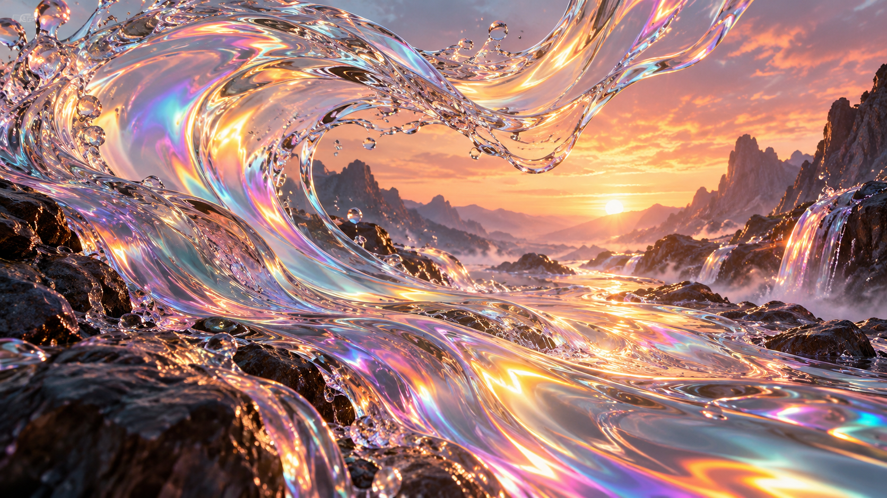

**Podstawy:** warstwowe półprzezroczyste powierzchnie podkreślające hierarchię. **Kiedy używać:** nawigacja i interfejs z wyraźnymi warstwami.

**Kompozycja:** nieprzezroczysta treść i jeden unoszący się panel. **Kolor:** jasne neutralne powierzchnie, ciemny tekst, niebieska akcja. **Typografia:** stabilny interfejsowy sans.

**Materiały:** szkło cyfrowe, kontrolowane rozmycie, pełne tło zastępcze. **Unikać:** nie rozmywaj wszystkiego i nie umieszczaj tekstu na zmiennym tle bez testu.

[Instrukcja i prompt do skopiowania →](skills/design-trends-2027/references/application-recipes.md#styl-08)

### 09. Expressive geometry

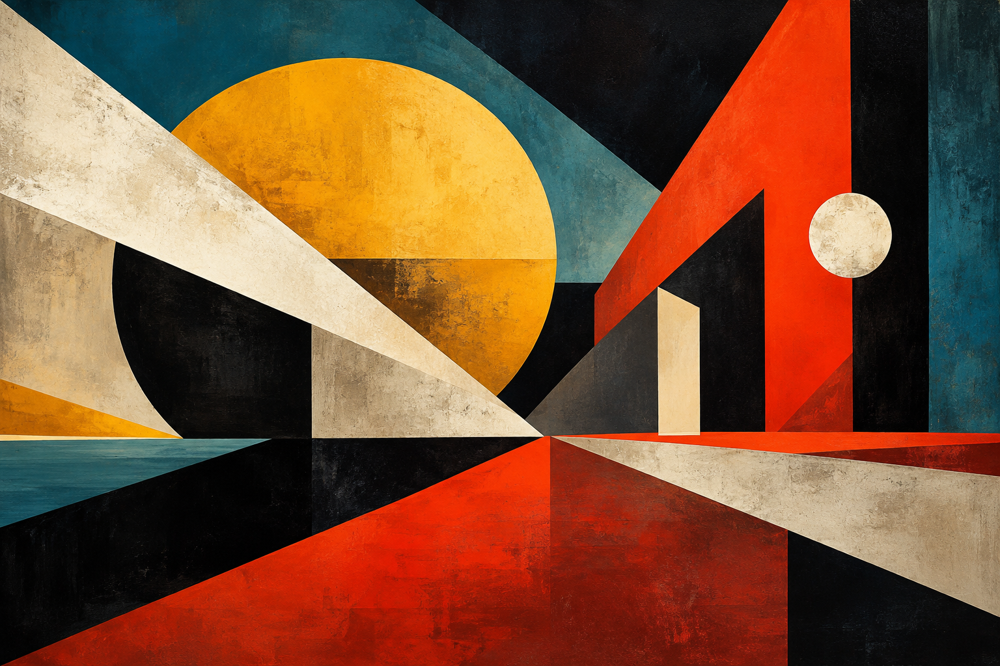

**Podstawy:** powtarzalny system dwóch lub trzech form. **Kiedy używać:** rozpoznawalna identyfikacja i system kampanii.

**Kompozycja:** siatka i jedna dominująca figura, reszta pomocnicza. **Kolor:** kość słoniowa, atrament, turkusowy akcent. **Typografia:** geometryczny display i neutralny sans.

**Materiały:** oryginalne wektory i czytelne konwencjonalne kontrolki. **Unikać:** nie udawaj interakcji dekoracją ani nie koduj stanów tylko kolorem.

[Instrukcja i prompt do skopiowania →](skills/design-trends-2027/references/application-recipes.md#styl-09)

### 10. Purposeful motion

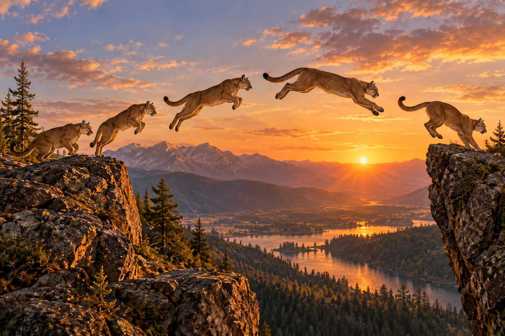

**Podstawy:** ruch wyjaśnia zmianę, orientację lub reakcję. **Kiedy używać:** interfejsy i narracja cyfrowa z uzasadnioną animacją.

**Kompozycja:** najpierw pełny statyczny układ, potem jeden ruch znaczący. **Kolor:** neutralna powierzchnia, ciemny tekst, akcent działania. **Typografia:** stabilny czytelny sans.

**Materiały:** lekkie warstwy wektorowe, opcjonalnie licencjonowane media. **Unikać:** nie ukrywaj treści za animacją; obsłuż ograniczenie ruchu.

[Instrukcja i prompt do skopiowania →](skills/design-trends-2027/references/application-recipes.md#styl-10)

### 11. Playful retro computing

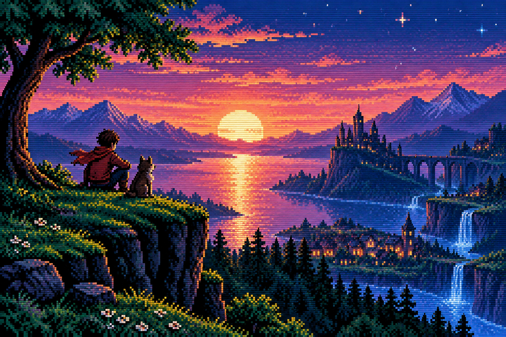

**Podstawy:** estetyka dawnych interfejsów jako współczesna zabawa. **Kiedy używać:** technologia, kultura, wydarzenia.

**Kompozycja:** okna i piksele jako ramy, realne działania wyraźnie odróżnione. **Kolor:** krem, błękit i pomarańcz. **Typografia:** czytelny monospace w detalach, prosty tekst.

**Materiały:** oryginalne ikony i pikselowe ornamenty. **Unikać:** nie kopiuj znaków ani nie zamieniaj ozdobnych okien w fałszywe kontrolki.

[Instrukcja i prompt do skopiowania →](skills/design-trends-2027/references/application-recipes.md#styl-11)

### 12. Quiet editorial

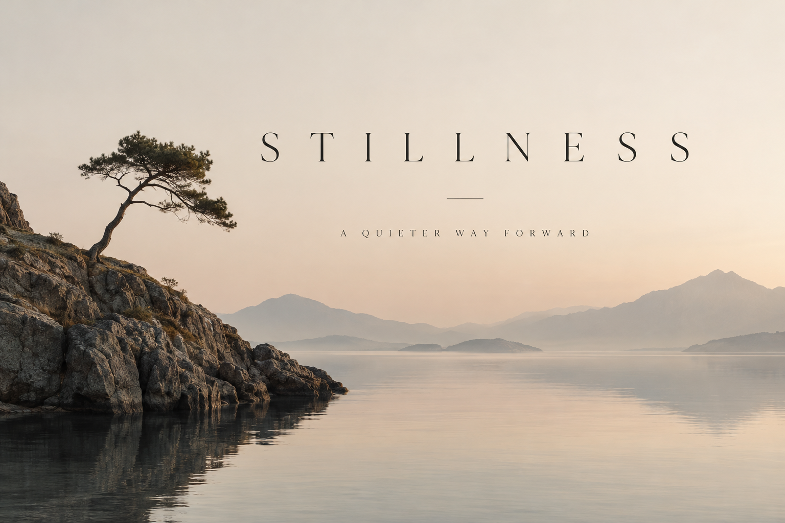

**Podstawy:** spokój, rytm i dużo oddechu. **Kiedy używać:** długie czytanie i opowieści premium.

**Kompozycja:** asymetryczna siatka, duże marginesy, jeden obraz. **Kolor:** ciepła biel, grafit, przygaszona zieleń. **Typografia:** elegancki szeryf i oszczędny sans.

**Materiały:** papier, autorska fotografia lub prosty render. **Unikać:** nie stosuj zbyt małego tekstu ani pustki bez hierarchii.

[Instrukcja i prompt do skopiowania →](skills/design-trends-2027/references/application-recipes.md#styl-12)

### 13. Ornamental maximalism

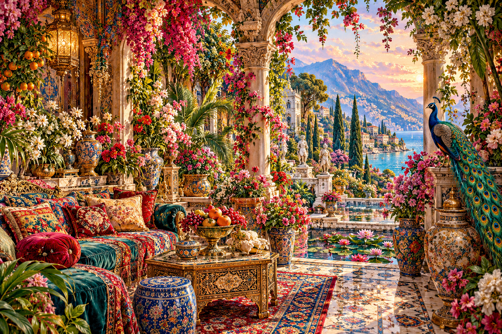

**Podstawy:** bogactwo ornamentu podporządkowane jednemu motywowi. **Kiedy używać:** kultura, hotelarstwo i ekspresyjny produkt.

**Kompozycja:** gęsta rama i spokojne centrum z komunikatem. **Kolor:** głęboka czerwień, krem, metaliczny akcent. **Typografia:** dekoracyjny display i prosty krój szczegółów.

**Materiały:** koronka, relief, srebro lub ich jawna cyfrowa interpretacja. **Unikać:** nie zasłaniaj treści ornamentem i nie mnoż motywów bez reguł.

[Instrukcja i prompt do skopiowania →](skills/design-trends-2027/references/application-recipes.md#styl-13)

### 14. Data poetry

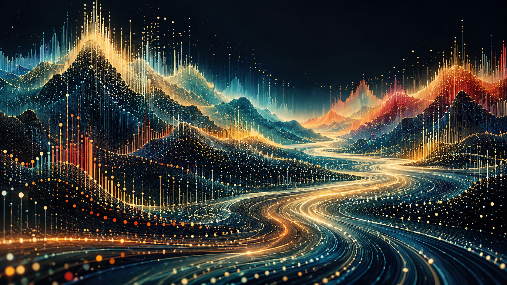

**Podstawy:** estetyczna forma oparta na uczciwym przedstawieniu informacji. **Kiedy używać:** artykuły i raporty z weryfikowalnymi danymi.

**Kompozycja:** jedna czytelna wizualizacja z legendą i kontekstem. **Kolor:** ciemny granat, jasne oznaczenia, pojedynczy akcent. **Typografia:** czytelny sans dla wartości i źródeł.

**Materiały:** rzeczywiste dane z datą i źródłem albo wyraźnie oznaczony wzór dekoracyjny. **Unikać:** nie prezentuj fikcyjnych punktów jako pomiarów.

[Instrukcja i prompt do skopiowania →](skills/design-trends-2027/references/application-recipes.md#styl-14)

### 15. Biomorphic sculpture

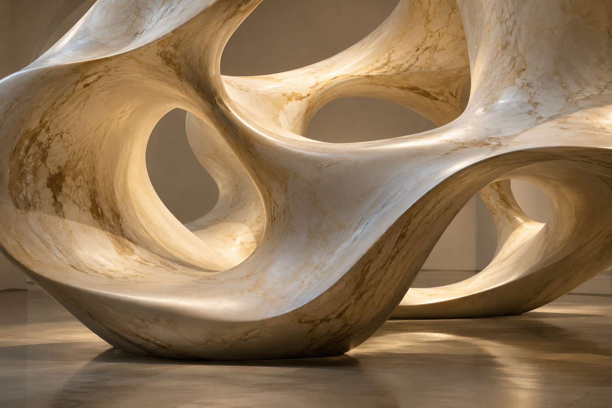

**Podstawy:** miękkie organiczne kształty jako rzeźbiarski język. **Kiedy używać:** identyfikacja inspirowana naturą i opowieść produktowa.

**Kompozycja:** jeden organiczny obiekt na spokojnym tle. **Kolor:** ziemia, kość słoniowa i zgaszona zieleń. **Typografia:** prosty sans kontrastujący z miękką formą.

**Materiały:** glina, drewno, autorska rzeźba lub oznaczony render. **Unikać:** nie przypisuj syntetycznemu obiektowi rzeczywistego pochodzenia.

[Instrukcja i prompt do skopiowania →](skills/design-trends-2027/references/application-recipes.md#styl-15)

### 16. Monochrome architecture

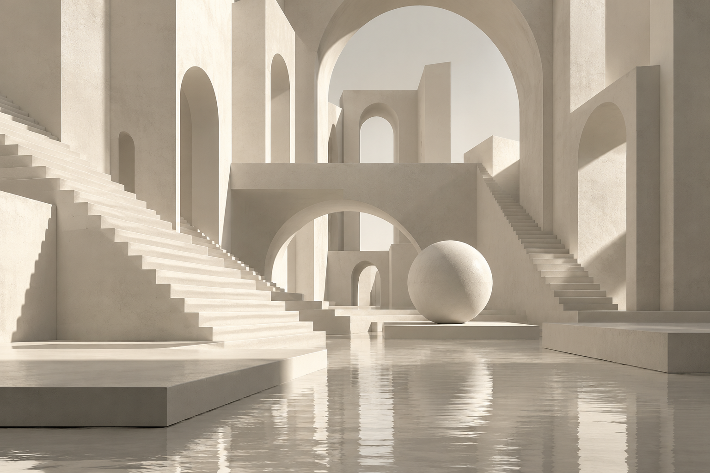

**Podstawy:** rytm konstrukcji i światłocień w ograniczonej palecie. **Kiedy używać:** editorial, architektura, odważna typografia.

**Kompozycja:** mocna siatka i jeden strukturalny motyw. **Kolor:** czerń, biel oraz szarości. **Typografia:** wyrazisty grotesk i prosty tekst pomocniczy.

**Materiały:** licencjonowana fotografia architektury lub abstrakcyjny render. **Unikać:** nie opieraj znaczenia wyłącznie na kolorze i nie przypisuj Bauhausowi monochromii.

[Instrukcja i prompt do skopiowania →](skills/design-trends-2027/references/application-recipes.md#styl-16)

### 17. Neo-Brutalism

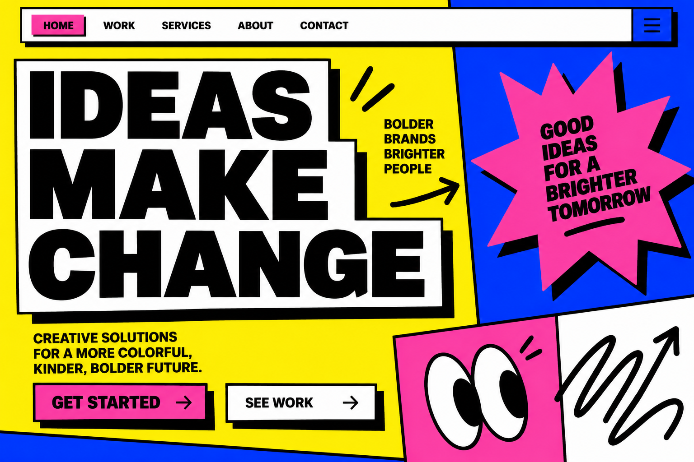

**Podstawy:** surowe bloki, grube obrysy i wyraziste cienie. **Kiedy używać:** odważne kampanie, strony i produkty o nieformalnym tonie.

**Kompozycja:** modułowa siatka, wyraźne obramowania, czytelne CTA. **Kolor:** dwa lub trzy intensywne kolory oraz czarny tekst. **Typografia:** ciężki grotesk w nagłówku, neutralny sans w tekście.

**Materiały:** płaskie wektory, ostre krawędzie, przesunięte twarde cienie. **Unikać:** nie zakładaj dostępności bez pomiaru kontrastu i testu sterowania.

[Instrukcja i prompt do skopiowania →](skills/design-trends-2027/references/application-recipes.md#styl-17)

### 18. Risograph Layers

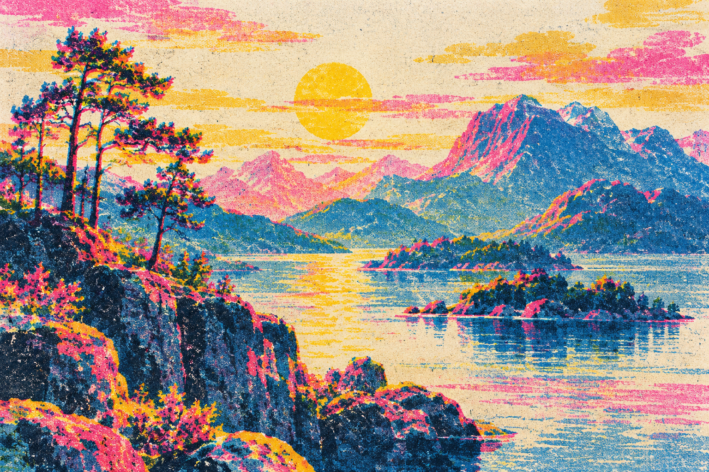

**Podstawy:** warstwy farb, raster i subtelne przesunięcie pasowania. **Kiedy używać:** plakaty, zin i identyfikacja kulturalna.

**Kompozycja:** dwie lub trzy warstwy z centralnym motywem i spokojnym blokiem tekstu. **Kolor:** ograniczona paleta farb punktowych, np. niebieski i róż. **Typografia:** masywny nagłówek, mały tekst w jednej ciemnej farbie.

**Materiały:** papier, półprzezroczyste nadruki, rastry; przy druku osobna separacja na farbę. **Unikać:** nie nakładaj kilku farb na drobny tekst; uzgodnij specyfikację z drukarnią.

[Instrukcja i prompt do skopiowania →](skills/design-trends-2027/references/application-recipes.md#styl-18)

### 19. Cinematic Light & Shadow

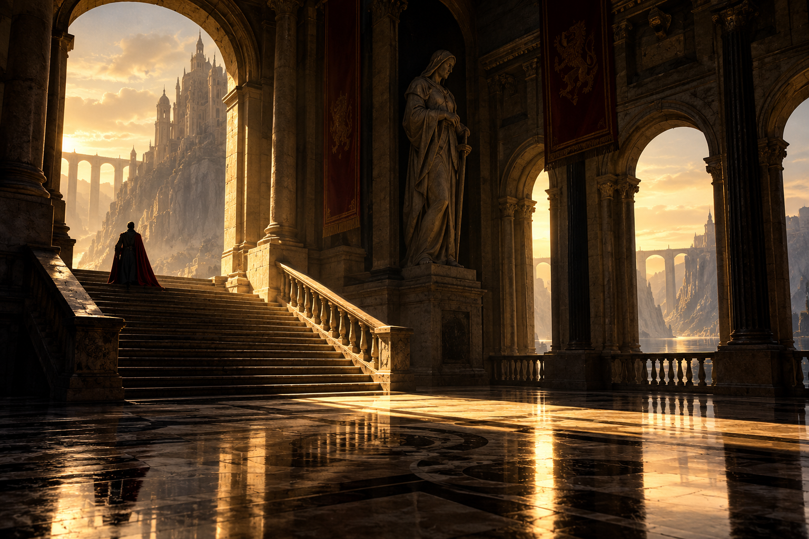

**Podstawy:** kierunkowe światło i kontrolowany cień budują dramaturgię. **Kiedy używać:** kampania premium, portret, prezentacja produktu.

**Kompozycja:** jeden punkt skupienia, światło boczne i czytelna przestrzeń na tekst. **Kolor:** głębokie neutralne cienie i jeden ciepły lub chłodny akcent. **Typografia:** oszczędny wyrazisty nagłówek, spokojny tekst.

**Materiały:** fotografia lub render, światło kluczowe i kontrolowane wypełnienie. **Unikać:** nie gub detali produktu w czerni i nie twierdź, że render jest zdjęciem.

[Instrukcja i prompt do skopiowania →](skills/design-trends-2027/references/application-recipes.md#styl-19)

### 20. Soft 3D / Clay

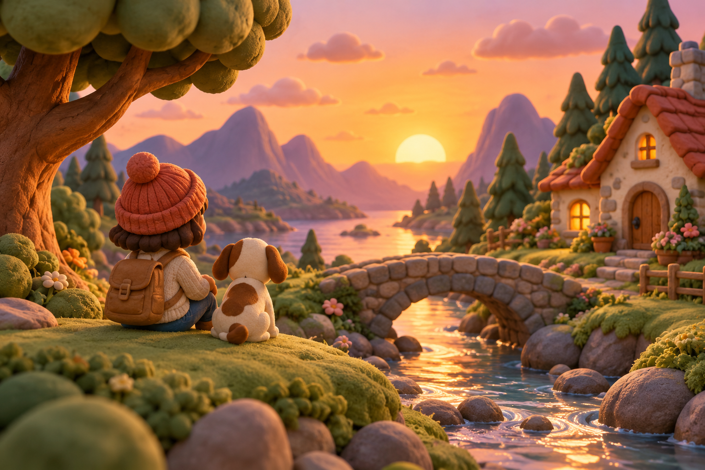

**Podstawy:** zaokrąglone bryły o miękkim, matowym wykończeniu. **Kiedy używać:** przyjazne ilustracje, onboarding i opakowania.

**Kompozycja:** jeden duży obiekt, kilka prostych elementów i wolna przestrzeń. **Kolor:** stonowane pastele i ciemny kolor tekstu. **Typografia:** przyjazny display oraz czytelny sans.

**Materiały:** glina lub render glinopodobny, rozproszone światło i miękkie cienie. **Unikać:** nie myl syntetycznej faktury z prawdziwą gliną i nie używaj niskiego kontrastu.

[Instrukcja i prompt do skopiowania →](skills/design-trends-2027/references/application-recipes.md#styl-20)

### 21. Botanical X-ray

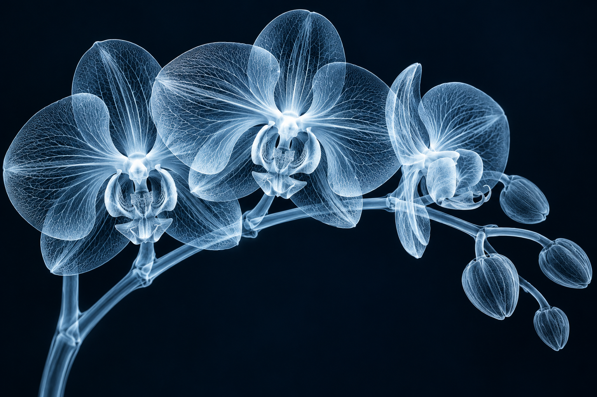

**Podstawy:** półprzezroczysty motyw roślinny z widocznym unerwieniem. **Kiedy używać:** redakcja naukowa i koncepty beauty.

**Kompozycja:** jeden obiekt na ciemnym pustym tle. **Kolor:** granat i chłodna biel. **Typografia:** precyzyjny prosty sans.

**Materiały:** syntetyczna radiografia lub autoryzowany rzeczywisty skan. **Unikać:** nie przedstawiaj ilustracji jako badania ani dowodu medycznego. Prześwietlenie tworzy wrażenie wewnętrznej struktury; nie jest zapisem naukowym.

[Instrukcja i prompt do skopiowania →](skills/design-trends-2027/references/application-recipes.md#styl-21)

### 22. Topographic Paper Relief

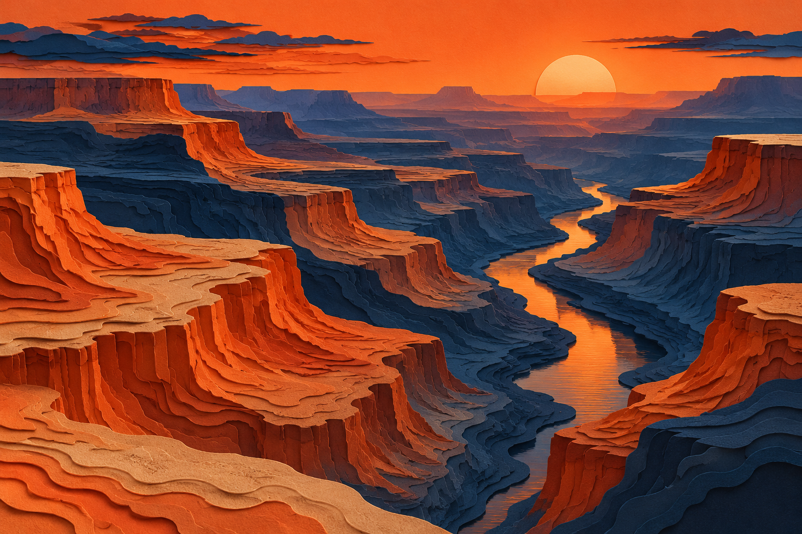

**Podstawy:** warstwowe wycinane kontury o przestrzennych krawędziach. **Kiedy używać:** opakowania outdoor i okładki.

**Kompozycja:** warstwice jako centralny relief i spokojny margines. **Kolor:** indygo i pomarańcz. **Typografia:** mocny sans i proste podpisy.

**Materiały:** papierowy model lub oznaczony render. **Unikać:** nie przedstawiaj dekoracyjnych warstwic jako mapy terenu. Rytm warstw i cienie budują topografię, nie rzeczywiste dane.

[Instrukcja i prompt do skopiowania →](skills/design-trends-2027/references/application-recipes.md#styl-22)

### 23. Cyanotype Specimens

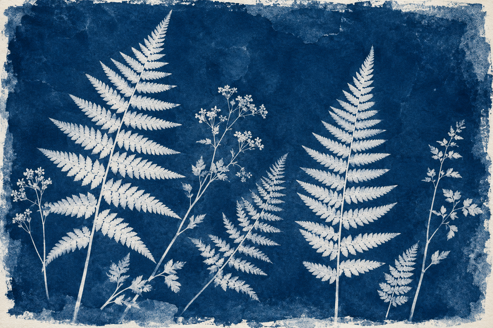

**Podstawy:** białe sylwetki roślin na błękicie pruskim. **Kiedy używać:** wydawnictwa botaniczne i opakowania.

**Kompozycja:** jedna sylweta na równym polu z miejscem na tekst. **Kolor:** błękit pruski i złamana biel. **Typografia:** oszczędny szeryf i czytelny sans.

**Materiały:** rzeczywista cyjanotypia lub jawna symulacja. **Unikać:** nie nazywaj symulacji ręcznie wykonanym odbitkiem. Od 21 różni się nieprzezroczystym fotogramem na papierze zamiast rentgenowskiej przezroczystości.

[Instrukcja i prompt do skopiowania →](skills/design-trends-2027/references/application-recipes.md#styl-23)

### 24. Jacquard Optics

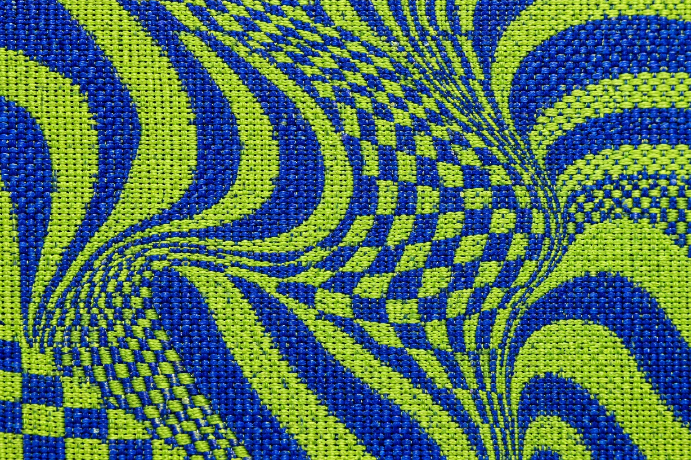

**Podstawy:** geometryczny wzór z czytelnym przeplotem osnowy i wątku. **Kiedy używać:** moda i wnętrza.

**Kompozycja:** duży wzór i wydzielona strefa informacji. **Kolor:** kobalt i limonka. **Typografia:** zwarty sans w kontrze do tekstury.

**Materiały:** oryginalna tkanina żakardowa lub syntetyczna symulacja. **Unikać:** nie obiecuj faktury fizycznej ani nie gub tekstu w splocie. Wzór powstaje z przeplotu włókien, a nie dekoracyjnego rysunku.

[Instrukcja i prompt do skopiowania →](skills/design-trends-2027/references/application-recipes.md#styl-24)

### 25. Prismatic Foil Emboss

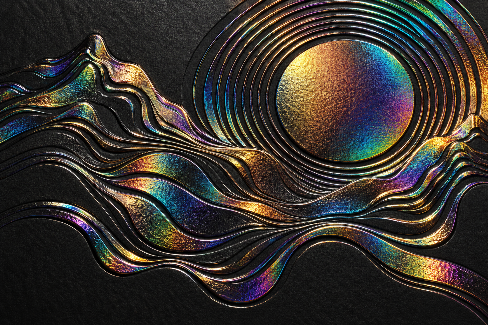

**Podstawy:** wytłoczona folia z kierunkowym spektralnym połyskiem. **Kiedy używać:** limitowane edycje i opakowania.

**Kompozycja:** jeden akcent foliowy na matowym polu. **Kolor:** czarny i widmowe refleksy. **Typografia:** stonowany krój premium i czytelne dane.

**Materiały:** próbka folii lub jawny render materiału. **Unikać:** nie gwarantuj identycznego efektu w druku bez próby. W przeciwieństwie do 08 nacisk pada na nieprzezroczystą metaliczną folię.

[Instrukcja i prompt do skopiowania →](skills/design-trends-2027/references/application-recipes.md#styl-25)

### 26. Exploded Blueprint

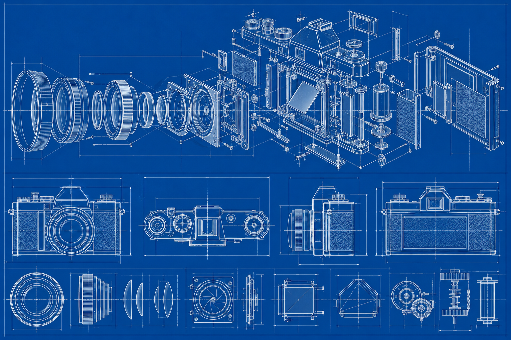

**Podstawy:** rozstrzelony schemat części z liniami konstrukcyjnymi. **Kiedy używać:** produkty techniczne i instrukcje koncepcyjne.

**Kompozycja:** części wzdłuż osi i oddzielna legenda. **Kolor:** kobalt i biel. **Typografia:** techniczny sans z czytelnymi podpisami.

**Materiały:** zweryfikowany rysunek techniczny lub oznaczony koncept. **Unikać:** nie używaj fikcyjnych części jako instrukcji serwisowej. Rysunek wyjaśnia relacje części, nie stanowi dekoracyjnej wizualizacji danych 14.

[Instrukcja i prompt do skopiowania →](skills/design-trends-2027/references/application-recipes.md#styl-26)

### 27. False-Colour Infrared

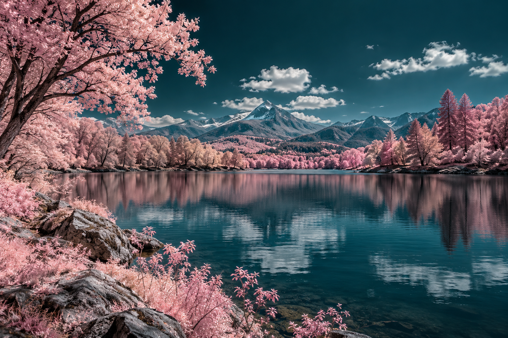

**Podstawy:** fałszywe kolory roślinności i tonalna fotografia krajobrazu. **Kiedy używać:** editorial i okładki muzyczne.

**Kompozycja:** jeden spokojny krajobraz z wyraźnym horyzontem. **Kolor:** róż roślinności i ciemny turkus. **Typografia:** neutralny sans bez efektów.

**Materiały:** licencjonowane zdjęcie IR lub syntetyczna interpretacja. **Unikać:** nie opisuj obrazu jako pomiaru temperatury. Obraz interpretuje podczerwień, nie jest rzeczywistym pomiarem.

[Instrukcja i prompt do skopiowania →](skills/design-trends-2027/references/application-recipes.md#styl-27)

### 28. Modern Stained Glass

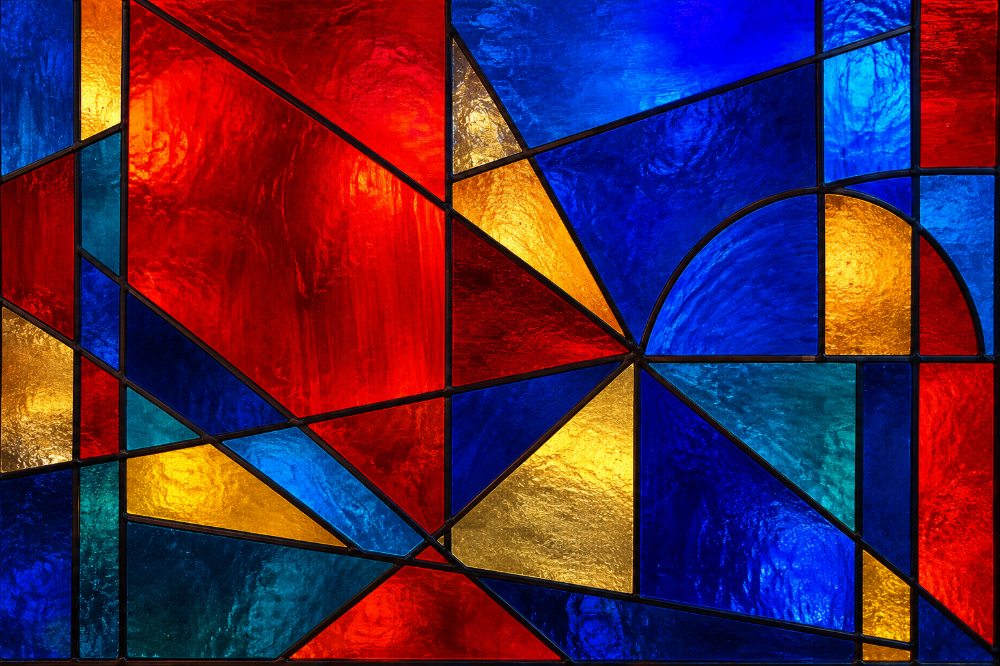

**Podstawy:** kolorowe płaszczyzny szkła oddzielone ciemnymi szprosami. **Kiedy używać:** plakaty kulturalne i grafiki przestrzeni.

**Kompozycja:** kilka dużych pól z wyraźnym rytmem łączeń. **Kolor:** rubin i ultramaryna. **Typografia:** prosty krój kontrastujący z geometrią.

**Materiały:** autorskie szkło lub oznaczona cyfrowa interpretacja. **Unikać:** nie kopiuj rozpoznawalnego zabytkowego wzoru. Od 08 różni się segmentacją nieprzezroczystymi łączeniami i światłem od tyłu.

[Instrukcja i prompt do skopiowania →](skills/design-trends-2027/references/application-recipes.md#styl-28)

### 29. Pixel-Sorted Portrait

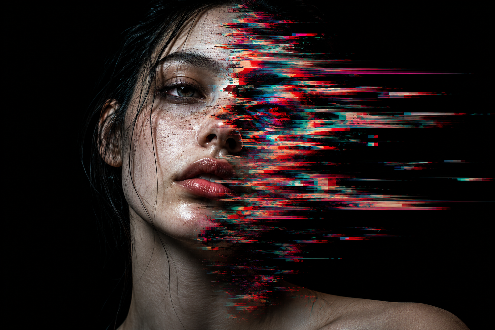

**Podstawy:** portret z kontrolowanym cyfrowym rozciągnięciem pikseli. **Kiedy używać:** muzyka i kampanie artystyczne.

**Kompozycja:** rozpoznawalna twarz z efektem w wybranej strefie. **Kolor:** czerń oraz kontrolowane rozdzielenie RGB. **Typografia:** czytelna typografia poza deformacją.

**Materiały:** autoryzowany portret lub fikcyjny syntetyczny model. **Unikać:** nie deformuj informacji ani twarzy osoby bez zgody. Efekt dotyczy cyfrowego rozpadu obrazu, a nie nostalgicznego interfejsu 11.

[Instrukcja i prompt do skopiowania →](skills/design-trends-2027/references/application-recipes.md#styl-29)

### 30. Solarized Duotone

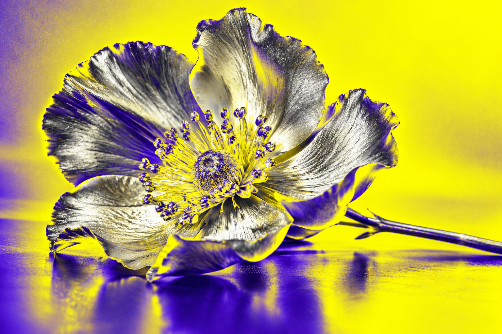

**Podstawy:** fotograficzna solaryzacja i tonalne odwrócenie krawędzi. **Kiedy używać:** okładki i beauty editorial.

**Kompozycja:** jeden przedmiot z kontrastową obwódką. **Kolor:** kwasowy żółty i fiolet. **Typografia:** spokojny sans, informacja poza obrazem.

**Materiały:** oryginalna fotografia lub wyraźnie oznaczony render. **Unikać:** nie przedstawiaj kolorów produktu jako wiernych. To transformacja tonalna fotografii, a nie raster i separacje riso 18.

[Instrukcja i prompt do skopiowania →](skills/design-trends-2027/references/application-recipes.md#styl-30)
